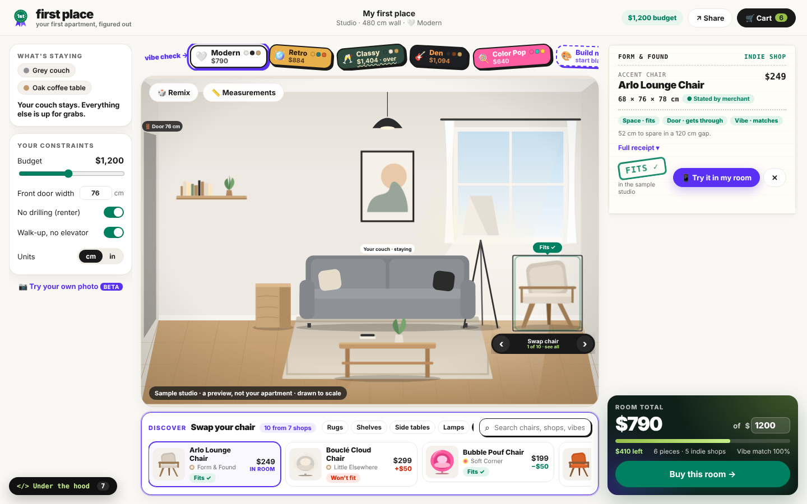

# First Place

**See your first place come together before you buy a thing.**

First Place is a shopping app for people furnishing their first apartment. You start with a room instead of a search box. Pick a vibe, and pieces from independent Shopify shops appear together in your room, drawn to true scale. Every piece carries a **Fit Receipt** that answers four questions: will it fit my space, will it get through my door, does it go with what I already own, and can I afford the room? It also says how sure it is. Then you buy the whole room in one cart, and each shop stays the merchant of record.

Built as a prototype on the architecture of Shopify's **Global Catalog** (discovery across millions of merchants) and the **Universal Commerce Protocol (UCP)** (cart and checkout across merchants).



## Why

> Demo status: all products, shops and dimensions are sample data, and every Catalog/UCP call is simulated in the browser. Fewer returns and higher conversion are **hypotheses** this prototype is meant to explore, not results it demonstrates.

- Home & furniture converts at about **1.4%** online, one of the lowest of any category, and furniture returns run about **19–20%**.
- The top return reasons are wrong size, "looked different than expected", and confusion about scale. These are gaps in product content, not shopper mistakes.
- Stores feel safe because you see a room already put together. Online, every product page stands alone. First Place brings the assembled room back.

**Who it's for:** 22 to 28, just graduated, first job, first lease. Shops online by default, on a budget, and already owns a hand-me-down couch.

## The demo in 60 seconds

1. **Vibe check.** Flip between Modern, Retro, Classy, Den and Color Pop. Walls, floor, light and all six pieces change, and each sticker shows that vibe's room total.
2. **Measurements.** Shows true-scale widths and the free floor between pieces.
3. **Fit Receipt.** Tap any piece. Every verdict says where its numbers came from: *Sample merchant dimensions*, *Estimated size*, or *Dimensions unknown*. It never says "Fits" on a guessed size, and every verdict is labelled "in the sample studio".
4. **Ask the merchant.** Retro's Mod Egg Chair has no dimensions, so it says "Can't tell". A reply labelled as simulated appears first; only after you choose "Use these sample dimensions" does the verdict update.
5. **Renter rules.** "No drilling" flags wall-mounted shelves, and Discover shows freestanding swaps. "Walk-up" flags pieces over 30 kg.
6. **Discover.** Search and swap any slot across every shop. Each candidate is pre-scored for fit and shows what it adds to or saves from the total.
7. **Budget dock.** Type your budget, and every swap and vibe change recalculates the item subtotal, what's left, the shop count and the vibe match. Shipping, taxes and availability are left to each shop's checkout; the demo never invents them.
8. **View in AR** (simulated preview), **Share** (a 9:16 story card PNG), **Buy this room** (one cart grouped by shop), **Checkout** (a separate simulated handoff to each shop).
9. **Under the hood.** A live log of every `search_catalog`, `get_product`, `ask_business`, `cart.create`/`cart.update` and `checkout.create` call.

## Getting started

```bash
npm install
npm run dev
```

## Build and tests

```bash
npm run build
npm run test
```

The site deploys to GitHub Pages on every push to `main` (`.github/workflows/deploy.yml`). In the repo settings, set **Pages → Source** to **GitHub Actions** once.

## Architecture

**Who does what:** the Catalog would supply product discovery data. First Place supplies the room visualisation, style exploration, fit logic and budget comparisons. UCP would carry the commerce flow (cart, then one checkout handoff per shop). In this build, both connections are simulated.

```text
                  FIRST PLACE UI  (React, SVG room scene)
                        |
                        v
                   FIT ENGINE  (src/fit: pure, deterministic, tested)
                        |
              +---------+---------+
              |                   |
              v                   v
         CatalogClient         UcpClient
              |                   |
        +-----+-----+       +-----+-----+
        |           |       |           |
        v           v       v           v
      Mock        Live     Mock        Live
    Catalog     Catalog    UCP         UCP
```

- `src/fit/`: unit normalisation, free-span geometry, space, doorway, compatibility, renter checks, budget. No React.
- `src/catalog/`: `CatalogClient` and `UcpClient` contracts, mock implementations that filter the local catalog for real, and live stubs that point at `https://catalog.shopify.com/api/ucp/mcp`.
- `src/scene/`: one shared coordinate system (2 px per cm). Every illustration is normalised to its real bounding box.
- `src/store.ts`: a single source of truth (a tiny `useSyncExternalStore` store). The room, cart and totals are all derived from it, so they can't drift apart.

## What's simulated vs. real

**Real:** application architecture, room geometry, unit conversion, fit scoring, budget maths, product swaps, discovery filtering, cart grouping, shop subtotals, protocol event logging, every UI interaction.

**Simulated:** Global Catalog responses (60 products from 10 invented shops), merchant answers, UCP cart and checkout, shop checkout URLs, AR, and the photo calibration beta's intelligence.

## Assumptions

- The TypeScript interfaces in `src/catalog/types.ts` are **application-level contracts modelled on** Shopify's Global Catalog MCP (`search_catalog`, `lookup_catalog`, `get_product`, `ask_business`) and UCP Cart/Checkout. They are **not** the official wire schemas. Verify against shopify.dev/docs/agents before going live.
- Dimensions in the live Catalog may be merchant-stated, Shopify-inferred or missing. The prototype keeps that provenance and never invents numbers.
- The doorway check uses the box size when one is published, otherwise the item size (labelled as an estimate). It allows the item to be turned on its side, and ignores stairwells and turning radius.
- Taste matching is inferred from style tags and colour, and always labelled as inferred.
- The dependencies are deliberately minimal: React plus Vite. Motion, state and image export are hand-rolled.

## Next with more time

1. Live Global Catalog via MCP, with real dimensions provenance.
2. Multimodal `catalog.like` with your own room photo for taste matching.
3. Real AR through WebXR or AR Quick Look, using merchants' 3D models.
4. Generative room staging layered on top of the accurate product overlay.
5. Real UCP checkout through a trusted agent profile.
6. Merchant insights, for example: _"Your products were placed in 340 rooms. 22% of those placements were blocked by missing dimensions."_
7. Room measurement from 2–3 photos, and real availability and delivery estimates.
